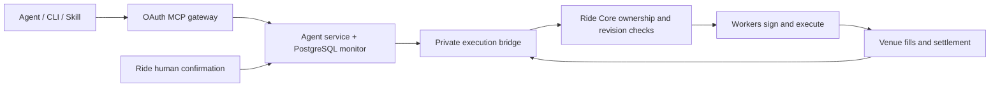

# Ride MCP · CLI · Skill

Ride Agent V3 selects a diversified trader basket and manages owned Perps and prediction-market copies. It exposes twenty-two Agent MCP tools plus an authenticated Ride App copy read and a live workflow guide, equivalent JSON CLI commands, compact MCP App cards, and a portable agent Skill.

**Release status:** the hosted V3 endpoint is `https://mcp.onride.me/mcp`. Account readiness and Ride approval govern trading. The CLI and Skill are distributed as `@glenyang/ride-cli`; client installation targets the same production MCP endpoint.

## One-command installation

Node.js 20+ and an AI client are required. Run this single command:

```sh
npx -y --prefer-online @glenyang/ride-cli@latest
```

The installer detects Codex, Claude Code and Cursor. With one detected client it continues automatically; with multiple or no detected clients it shows a short selection menu. It installs the Skill, connects the production MCP and opens Ride login. Authorize with your own Ride account, then restart your AI client or open a new chat. The default command requests read and proposal access; execution still requires confirmation in Ride.

For unattended configuration or an explicit client, the existing options remain available:

```sh
npx -y @glenyang/ride-cli@0.4.2 setup --client codex --trade
npx -y @glenyang/ride-cli@0.4.2 setup --client claude-code --trade
npx -y @glenyang/ride-cli@0.4.2 setup --client cursor --trade
```

Codex uses native HTTP MCP and its own OAuth credential storage. If the Codex CLI is absent, setup runs the official `@openai/codex@0.162.0` CLI through npx automatically. Claude Code and Cursor use the automatically updated Ride CLI's stdio MCP and private OAuth session. `setup` without `--trade` requests read access. Add `--skip-login` for configuration only; `--server https://YOUR-RIDE-HOST/mcp` selects another deployment.

Setup preserves unrelated settings, upgrades unmodified managed installations and refuses to overwrite a foreign `ride` entry or customized Skill. If login is cancelled or fails, rerun the same command to retry; the installed configuration is retained.

Registry installation is the default. The pinned GitHub source remains available with `npx -y github:Glen-yang/ride-mcp#v0.4.2 setup --client CLIENT --trade --distribution github`. Other clients supporting remote Streamable HTTP MCP with OAuth can connect to `https://mcp.onride.me/mcp`; their registration and consent interface is managed by that client. The installer currently configures Codex, Claude Code and Cursor.

For the Skill alone:

```sh
npx skills add Glen-yang/ride-mcp --skill ride
```

The Skill-only command does not register an MCP server. For standalone CLI commands, prefix the commands below with `npx -y @glenyang/ride-cli@0.4.2`, or install the pinned package with `npm install -g @glenyang/ride-cli@0.4.2` to obtain `ride`.

## Automatic updates and existing users

The installed Skill is a stable entry point. At the start of each Ride task it calls `get_ride_guide` to load the workflow from the configured Ride server. Deploying a new workflow updates its behavior without reinstalling local Skill files. The guide never grants new trading authority. If the live guide is unavailable, account reads and explanations can use the bundled reference; new financial proposals wait for the guide to recover.

Codex connects directly to the hosted MCP, so server tools and initialization instructions update on reconnect. Existing Codex HTTP installations can already discover the live guide after reconnecting or opening a new chat. Claude Code/Cursor npm installations resolve `@glenyang/ride-cli@latest` with `--prefer-online` whenever their MCP starts. A running chat does not hot-reload its tool catalog: reconnect MCP or start a new chat after a release. No update command is required after migration.

For existing pinned installations and static Skills, run **once** on the original computer:

```sh
npx -y --prefer-online @glenyang/ride-cli@latest setup --skip-login
```

Use `--client codex`, `--client claude-code` or `--client cursor` if multiple clients are installed, and retain a custom `--server` if one was configured. Migration accepts unmodified released Skills, preserves existing OAuth login and unrelated configuration, and refuses customized Skills or foreign Ride registrations. Already installed pinned code cannot remotely rewrite the user's computer before this migration. Explicit GitHub distribution and global `npm install -g` binaries stay pinned; standalone CLI users can run `npx -y --prefer-online @glenyang/ride-cli@latest COMMAND` instead of reinstalling.

The public, unauthenticated `ride guide --server URL` command reads the same workflow as MCP. Its version and content digest support consistency checks; OAuth sessions and account data are never included in this read.

## Use

```sh
ride login --server https://mcp.onride.me/mcp --trade
ride preferences --json '{"budget_usdc":"500","loss_trigger_pct":20,"market":"perps","assets":["BTC","ETH"]}'
ride recommend --pretty
ride copy start PLAN_ID
ride proposal PROPOSAL_ID
ride confirm PROPOSAL_ID
ride portfolio --pretty
ride copies --pretty
ride updates --limit 20
```

Account reads return the authenticated account together with Agent and existing Ride App copy data; an empty Agent portfolio confirms login and does not imply empty App holdings. `ride copies` reads existing App Perps and prediction copies directly. These copies remain managed in Ride.

Standalone `ride login` is separate from Codex native MCP login; Claude/Cursor setup already creates this CLI session. `login` defaults to read access; `--trade` adds proposal access. OAuth uses a browser, PKCE and a loopback callback. CLI session data remains under `~/.ride` with directory 0700 and file 0600; client configuration contains no access token. JSON is the default CLI output. `confirm` opens the Ride human review page.

| MCP tool                       | CLI equivalent                                    |
| ------------------------------ | ------------------------------------------------- |
| `get_ride_guide`               | `ride guide [--server URL]`                       |
| `get_preferences`              | `ride preferences`                                |
| `set_preferences`              | `ride preferences --json ...`                     |
| `get_deposit_options`          | `ride deposit options`                            |
| `get_deposit_address`          | `ride deposit address --json ...`                 |
| `prepare_deposit`              | `ride deposit prepare DEPOSIT_ID --json ...`      |
| `check_deposit_status`         | `ride deposit status DEPOSIT_ID`                  |
| `recommend_traders`            | `ride recommend`                                  |
| `get_trader_profile`           | `ride trader TRADER_ID`                           |
| `start_copy`                   | `ride copy start PLAN_ID`                         |
| `get_portfolio`                | `ride portfolio [PORTFOLIO_ID]`                   |
| `update_copy`                  | `ride copy update COPY_ID --json ...`             |
| `stop_copy`                    | `ride copy stop COPY_ID --mode wind_down`         |
| `review_portfolio`             | `ride review [PORTFOLIO_ID]`                      |
| `get_updates`                  | `ride updates --cursor CURSOR`                    |
| `close_position`               | `ride position close POSITION_ID`                 |
| `recalculate_plan`             | `ride plan recalculate PLAN_ID --json ...`        |
| `get_performance`              | `ride performance --period inception`             |
| `diagnose_copy`                | `ride diagnose COPY_ID --start-at MS --end-at MS` |
| `get_notification_preferences` | `ride notifications`                              |
| `set_notification_preferences` | `ride notifications --json ...`                   |

## Execution and accounting

Write tools create expiring, frozen proposals. Execution requires human approval inside Ride, or an explicit, revocable Ride grant bounded by portfolio, total/action/daily amounts, expiry, assets, markets and leverage. MCP OAuth trade scope does not itself authorize execution. MCP funding preparation returns an exact-amount human confirmation page; funding and wallet signatures stay on that authenticated page. There are no MCP withdrawal or signing tools.

Recommendations use fresh venue-specific General-pool scores, choose 3–6 feasible sleeves and conserve every micro-USDC. Perps defaults to BTC/ETH, ATR caps are 3–8x subject to source and venue limits, prediction leverage is 1x, sleeve stop loss defaults to 30%, and initial entries outside the 0.2% source-entry boundary wait for a new source cycle. New source assets outside the approved Perps preferences are excluded.

Suggested leverage is also capped so historical source drawdown multiplied by leverage stays within the user's loss percentage. Missing drawdown evidence or a Perps risk cap below 3x excludes that candidate.

A dedicated account and independent fill ledger keep sleeve ownership separate from legacy copy/manual trading. Gross concentration is limited to 60%; opposite Perps positions can offset their exchange target while retaining gross sleeve attribution. Distinct prediction outcomes retain separate token ownership. Fees, funding and external flows are attributed from account evidence. Incomplete profit is `null`, never fabricated from trader profit or treated as zero.

Backend monitoring persists independently of the conversation, follows source changes, reviews score/style daily and delivers persisted Inbox events plus push. Stops default to wind-down. `close_now`, loss triggers and owned position closes reconcile actual fills and pending orders. Loss triggers block increases and request exits; price gaps, liquidity and venue failures can exceed a loss threshold. Replacements are limited to one per seven days and require actual released funds.

Submission, partial fill, settlement and completion are distinct. Unknown submissions retain their original identity and reconcile before any retry. Prediction accounting requires authenticated order-scoped confirmed trades and chain transfer evidence. Ambiguous receipts, unclassified redemption/merge events, missing data or unsupported venue dust remain in attention and block new risk; they are not reported as completed. Automatic prediction redemption is not included in this release.

There is no application-level country allowlist. Venue eligibility and account readiness are checked independently.

The conversational cards follow the V17 exploration → preview → funding → fresh review flow. Saved previews remain refreshable for 90 days (latest 100 plans). Editing creates a new immutable plan, requires 3–6 unique traders and limits each capital weight to 55%; actual gross exposure is checked separately before execution. Native MCP Apps use `tools/call`; hosts without cards use the same Skill and CLI contracts.

Performance reports use immutable accounting snapshots, preserve closed/replaced copies and exclude external flows. Recording starts on deployment; absent historical periods are unavailable. Copy diagnosis displays source and attributed follower fills in the same window, execution decisions, event-time parameters and fees/funding. It does not fabricate trade pairing or counterfactual profit. Prediction source fill history currently remains unavailable; verified follower accounting still appears.

Daily reports are opt-in Ride App pushes with a local time and IANA timezone. The persistent server monitor queues one report per local day and retries delivery. Missing push credentials or registered devices are reported as unavailable. Turning off a digest cancels its queued pushes; risk alerts remain enabled.

## Architecture and self-hosting



The public gateway runs `npm start`; the durable control service runs `npm run start:backend`; the private execution bridge runs `npm run start:bridge`. Each is a separate process. `PORT` defaults are 3333/3344/3355 and `HOST` defaults to loopback. Protect the bridge and Core with distinct service credentials and private ingress. The bridge requires the additive Ride Core V3 API/migrations/worker changes; this repository does not contain the private Ride Core or native App.

See [deployment and configuration](docs/deployment.md) and [.env.example](.env.example). Keep secrets outside Git. Start with execution flags disabled. `RIDE_PUBLIC_SUBMISSION_MODE=true` exposes eleven read-only Agent/workflow tools and the App account read for directory submissions.

## Development

```sh
npm ci
npm run check
npm test
npm run build
npm pack --dry-run
```

Run the real PostgreSQL durability test with `RIDE_AGENT_TEST_DATABASE_URL` pointing to an isolated disposable database. Offline tests do not place real venue orders. GitHub CI checks schemas, permissions, accounting, OAuth, packaging and durable transactions.

To test the actual feature journey locally, use an isolated disposable PostgreSQL database:

```sh
RIDE_AGENT_FUNCTIONAL_DATABASE_URL='postgresql://USER@127.0.0.1:5432/ride_functional_acceptance' npm run test:functional
```

This starts the real MCP gateway, HTTP backend, OAuth PKCE flow and CLI, and runs 36 scenarios through the Agent tools, live guide and account reads with persisted PostgreSQL state. It covers recommendation risk filters, frozen human proposals, partial fills, fees/funding, position closes, wind-down, delegated limits, both loss triggers, replacement limits, stale proposals and monitor recovery. Only Core identities and venue reads/fills are simulated; this does not verify a real login, wallet signing or exchange settlement. The script removes its own fixture states and writes `output/deployment/functional-acceptance.json` with every scenario and tool response.

MIT. The open repository is created from a clean history and contains no private Ride repository history, credentials, or user account data.

Conversational features include single or 2–8 trader previews, fixed/proportional copying, separate risk preferences, saved recommendation batches, overlap review, deposit addresses/QR and status, daily check-ins and net-profit/account-value charts. Existing portfolios preserve their original limits and stop rules. See [V17 behavior and acceptance](docs/conversational-v17.md). Perps wallet receipt and venue funding remain distinct; RWA requires verified USDC collateral in Standard account scopes.

Recommendation onboarding now returns missing preference questions and persists partial answers before fetching candidates. Perps funding continues from the owned receiving wallet through browser confirmation, optional Embedded Wallet signature, trading-account activation and verified trading balance. Prediction status verifies trading collateral separately from bridge completion. Old App routes and deployments remain independent.


Widget/account repairs in 0.4.3 default asset preferences to unrestricted Crypto/RWA, keep candidates visible without a plan, and explain feasible trader counts without changing risk settings. `get_portfolio` separates per-market balances from copy allocations; missing modules remain unavailable. See [behavior, coverage and acceptance](docs/widget-account-v043.md).
